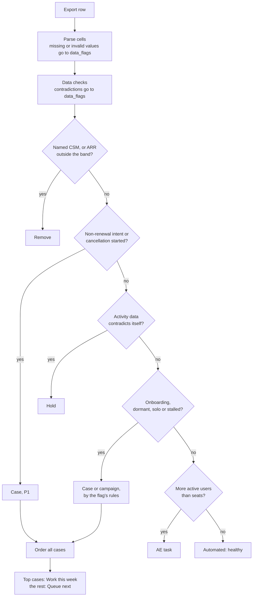

# How it works

The engine reads one export row at a time, applies the rules in a fixed order, and stops at the first rule
that decides the route. Then it orders every case and fills this week's capacity. All thresholds come from
[`config/queue_rules.yaml`](../config/queue_rules.yaml); the [policy reference](policy-reference.md) explains
each one.

The code is in [`pooled_queue/engine.py`](../pooled_queue/engine.py). `decide()` handles one row and
`triage()` handles the whole export.

## The order rules are applied

### 1. Parse the row

Each cell named in `columns` is read and cleaned. Numbers may contain commas or a dollar sign. A blank or
unreadable cell becomes unknown and is recorded in `data_flags` (for example `Missing renewal_date`). The
row still gets a decision. See the [data dictionary](data-dictionary.md) for every column.

### 2. Check the data

The data checks look for numbers that can't all be true at once: active seats far above active users, a
last review older than the signup, ARR that doesn't match the seat price, a renewal date in the past. Each
problem is written to `data_flags` in words a CSM can act on.

One problem is serious enough to stop outreach: very few active users while many seats show as active. If
`hold_on_contradiction` is on, that row is held (step 5).

### 3. Remove what the pool doesn't own

An account with a named CSM, or with ARR above or below the band, is removed with a reason saying where it
belongs. A row with unknown ARR stays in the band and carries a data flag.

### 4. Intent always opens a case

Inside the band, non-renewal intent or a started cancellation opens a P1 case, whatever else is wrong with
the row. This is the one rule that overrides a hold.

### 5. Hold contradictory rows

A row whose activity data contradicts itself gets no outreach and no campaigns until someone verifies it.

### 6. Apply the account flags

The flags are worked out first, then checked in this order. The first match decides.

| Flag | Condition | Routes to |
| --- | --- | --- |
| Onboarding | Signed up within `flags.onboarding.max_days_since_signup` days | Automated: onboarding nurture. The other flags wait until onboarding ends |
| Dormant, deep | Nobody active, configured to `deep_level` or above | Case at `deep_priority`, any distance from renewal |
| Dormant, near renewal | Nobody active, inside `near_renewal_days` of renewal | Case at `near_renewal_priority` |
| Dormant, campaign ran out | Nobody active for `idle_days_to_fire` plus `track_days` | Case at the `automation_exhausted` priority |
| Dormant | Nobody active | Automated: re-engagement campaign, with the days left before it becomes a case |
| Solo, near renewal | Exactly one active user, inside the solo window | Case at the solo priority |
| Solo | Exactly one active user | Automated: "bring your team" campaign |
| Stalled, near renewal | At L1 with two or more active users, inside the stalled window | Case at the stalled priority |
| Stalled | At L1 with two or more active users | Automated: configuration campaign |

Monthly-term accounts can leave at any month end, so with `monthly_always_in_window` on they count as inside
every renewal window. A row with no renewal date is never inside a window.

### 7. Seat headroom and healthy accounts

An account still without a route that has more active users than seats goes to the account executive, with
the headroom priced at `band.price_per_seat`. Everything else is healthy and left to automation.

### 8. Notes for the CSM

Whatever the route, the engine adds notes to `also` when they matter to the first touch:

- seat headroom on an account that is a case, so the AE hears about it too
- expansion that would take the account above the band, which means a named CSM
- recent support tickets to read before reaching out

### 9. Order the cases and fill the week

Cases are sorted by:

1. priority (P1, then P2, then P3)
2. renewal window: inside 7, 30, 90, 180 days, then later
3. deeper configuration first, because more is at stake
4. higher ARR

The first `capacity.this_week_cases` cases become **Work this week**. The rest become **Queue (next)** and
keep their rank.

## Customer requests

A customer asking for help doesn't wait for the nightly run. Once support triages the request into a bucket,
`triage_request()` routes it with the same policy:

1. Out-of-band accounts and named-CSM accounts are removed, as in step 3.
2. Non-renewal intent or a started cancellation opens a P1 case, whatever the bucket.
3. An `advisory` request opens a case. It gets `raised_priority` if the account already carries a dormant,
   solo or stalled flag, or renews within `raise_within_days`; otherwise the base `priority`.
4. `known_friction` goes to Automated (a docs answer), `break_fix` to Support and `buying` to the AE.

An unknown bucket is an error, not a silent default. The case is ranked with every other case by the same
sort order.

## Reading the work list

`out/worklist.csv` is the export with nine columns added. Sort by `rank` to see the cases in order, and
filter `route` to see each lane.

| Column | Example |
| --- | --- |
| `route` | `Work this week` |
| `priority` | `P1` |
| `rank` | `2` |
| `sla_business_days` | `2` |
| `signals` | `Dormant · L4` |
| `reason` | `Configured to L3+ and nobody active: something broke.` |
| `first_touch` | `To the admin, citing their own setup: reviews stopped on 2026-09-01. What changed?` |
| `also` | `read the 2 recent support ticket(s) before the first touch` |
| `data_flags` | `44 active seats vs 33 active users: confirm before any seat quote` |

The [data dictionary](data-dictionary.md) defines each column.

## What the engine doesn't do

- **It doesn't track cases.** It decides which accounts need one. Opening, working and closing cases happen
  in the support tool.
- **It doesn't know campaign history.** A dormant account's campaign is assumed to start when the flag
  fires, so its age comes from days since the last review. The export has no start date for solo or
  stalled campaigns, so the engine can't open their day-21 cases itself. That needs campaign data.
- **It doesn't learn.** Changing a threshold is a pull request to the policy file, reviewed like any change.
