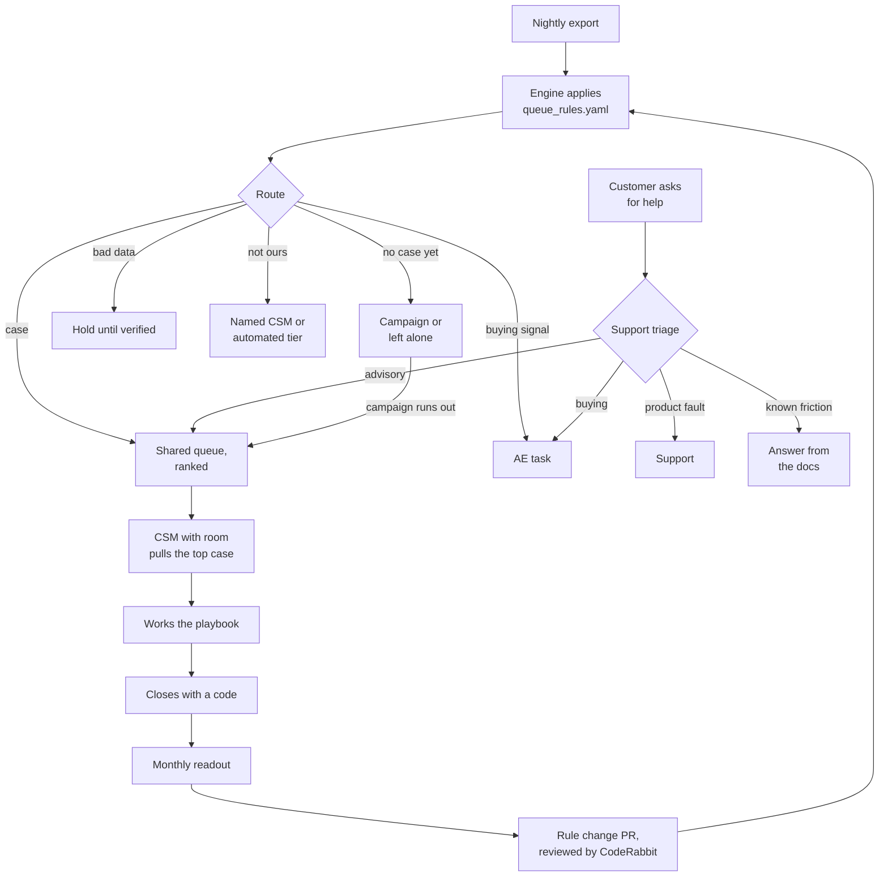

# Walkthrough: from signal to closed case

How the system puts work in front of a pooled CSM, step by step, and how each step maps to the four parts of
the exercise: the queue, the export, one playbook, and capacity, readout and hiring.

## The loop



Nobody owns an account. Accounts surface when a signal fires or a customer asks for help, a CSM works the
case, and the case closes.
What the team learns from closed cases changes the rules, and the rules decide what surfaces next.

## Step by step

### 1. A signal fires, or a customer asks (exercise part 1: the queue)

Work comes in three ways. The customer submits nothing in the first two:

1. **A signal fires.** Every night the account export runs through the engine. Each account gets one route,
   with a reason a CSM can read.
2. **The customer says they may leave.** Non-renewal intent recorded by anyone, or a cancellation started in
   billing, opens a P1 case at the next run.
3. **The customer asks for help.** A support form collects what they're trying to do, the repo, what they've
   tried and how urgent it is. Support triages it, and only how-to and adoption questions become pooled cases.

| Signal | Becomes a case when | Otherwise |
| --- | --- | --- |
| Non-renewal intent or cancellation started | Always, inside the band | n/a |
| Dormant: nobody active | Deeply configured, near renewal, or its campaign ran out | Re-engagement campaign |
| Solo: one active user | Near renewal (monthly terms always) | "Bring your team" campaign |
| Stalled onboarding: in use, still on defaults | Near renewal | Configuration campaign |
| Seat headroom: more users than seats | Never | AE task |
| Data that contradicts itself | Never, until verified | Hold |
| Customer asks for help | Triaged as advisory | Docs answer, Support or the AE |

The exact windows, priorities and SLAs live in [`config/queue_rules.yaml`](../config/queue_rules.yaml). The
[queue design](queue-design.md) states them in plain language, including what closes a case and every
hand-off.

### 2. Cases are ranked (exercise part 1)

When there are more cases than the team can take, the order is fixed: priority, then how close the renewal
is, then deeper configuration, then higher ARR. A P3 left unworked for 5 business days moves up to P2.
Nothing is promoted to P1.

### 3. The work list is produced (exercise part 2: the export)

```bash
python -m pooled_queue.cli data/sample_export.csv --as-of 2026-10-05
```

The command prints this week's cases in order, lists rows whose data doesn't add up, and writes every
account's route, rank, SLA, reason, first touch and data flags to `out/worklist.csv`. The worked version of the
exercise's own 40-account export was submitted separately, built from the same rules.

Data problems are flagged, never dropped: missing cells, ARR that doesn't match seats, active seats far above
active users, a last review older than the account. The [data dictionary](data-dictionary.md) lists each one
and what happens to the row.

### 4. A CSM pulls a case

The CSM with room takes the highest-ranked open case. [Working the queue](working-the-queue.md) covers how
that works on day one: the cap, the SLA, the daily rhythm and what to do with each kind of note on a case.

### 5. The CSM works the playbook (exercise part 3)

Each trigger has a playbook. The [solo-user playbook](playbooks/solo-user.md) is written end to end: what to
read before the first touch, every step with an owner and a time, what to send, what to do when the customer
doesn't answer, what closes the case, and what to record.

### 6. The case closes and the team learns

Every case closes with a code and a blocker. A fix used three times becomes an automated campaign step, so
the queue gets lighter as the team learns.

### 7. The readout measures it (exercise part 4)

Once a month the team reports effort (cases, SLA hit rate, touches) apart from outcome (flags cleared,
renewals kept). The main number is gross revenue retention on renewals that carried a flag. A random holdout
on the solo playbook shows whether the team, not time, made the difference.

### 8. The rules change through a pull request

When the readout shows a trigger firing too often or too late, the fix is a change to
`config/queue_rules.yaml`. CodeRabbit reviews it against [`AGENTS.md`](../AGENTS.md) and the path
instructions, fails any pull request that hard-codes a threshold in Python, and warns until the description
states the change's effect on weekly case volume. See [CodeRabbit setup](coderabbit-setup.md).

## Where each part of the exercise lives

| Exercise part | In this repo | In the submitted deck and sheet |
| --- | --- | --- |
| 1. The queue: signals, ordering, response standards, closing, hand-offs | `config/queue_rules.yaml`, [queue design](queue-design.md), [how it works](how-it-works.md) | Slides 2 and 3 |
| 2. The export: this week's ten, routes with reasons, the first data ask, bad rows | The work list from the CLI, [data dictionary](data-dictionary.md) | Slides 4 and 5; the worked sheet |
| 3. One playbook | [Solo-user playbook](playbooks/solo-user.md) | Slides 6 and 7 |
| 4. Capacity, readout and first hires | [Working the queue](working-the-queue.md) for capacity and a day on the queue | Slides 8, 9 and 10 |
| Use CodeRabbit on a repository of your own | This repo, configured L1 to L4, and its pull requests | Slide 1 links here |

The design adapts a pooled intake and capacity model the author built in a previous scaled customer success
role.
