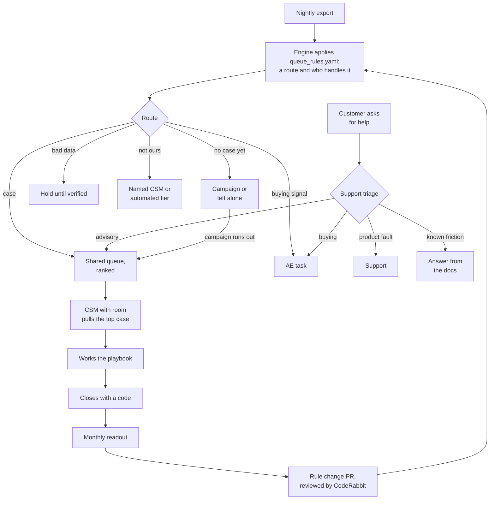

# Walkthrough: from signal to closed case

How the system puts work in front of a pooled CSM, step by step, and how each step maps to the four parts of
the exercise: the queue, the export, automation and AI, one playbook, and capacity, readout and hiring.

## The loop



Nobody owns an account. Accounts surface when a signal fires or a customer asks for help, a CSM works the
case, and the case closes.
What the team learns from closed cases changes the rules, and the rules decide what surfaces next.

## Step by step

### 1. A signal fires, or a customer asks (exercise part 1: the queue)

Work comes in three ways. The customer submits nothing in the first two:

1. **A signal fires.** Every night the account export runs through the engine. Each account gets one route,
   with a reason a CSM can read.
2. **The customer says they may leave.** Non-renewal intent recorded by anyone, or a cancellation started in
   billing, opens a P1 case at the next run.
3. **The customer asks for help.** A support form collects what they're trying to do, the repo, what they've
   tried and how urgent it is. Support triages it, and only how-to and adoption questions become pooled cases.

| Signal | Becomes a case when | Otherwise |
| --- | --- | --- |
| Non-renewal intent or cancellation started | Always, inside the band | n/a |
| Dormant: nobody active | Deeply configured, near renewal, or its campaign ran out | Re-engagement campaign |
| Solo: one active user | Near renewal (monthly terms always) | "Bring your team" campaign |
| Stalled onboarding: in use, still on defaults | Near renewal | Configuration campaign |
| Seat headroom: more users than seats | Never | AE task |
| Data that contradicts itself | Never, until verified | Hold |
| Customer asks for help | Triaged as advisory | Docs answer, Support or the AE |

The exact windows, priorities and SLAs live in [`config/queue_rules.yaml`](../config/queue_rules.yaml). The
[queue design](queue-design.md) states them in plain language, including what closes a case and every
hand-off.

### 2. Cases are ranked (exercise part 1)

When there are more cases than the team can take, the order is fixed: priority, then how close the renewal
is, then deeper configuration, then higher ARR. A P3 left unworked for 5 business days moves up to P2.
Nothing is promoted to P1.

### 3. The work list is produced (exercise part 2: the export)

```bash
python -m pooled_queue.cli data/sample_export.csv --as-of 2026-10-05
```

The command prints this week's cases in order, with who handles each, lists rows whose data doesn't add up,
and writes every account's route, handler, rank, SLA, reason, first touch and data flags to
`out/worklist.csv`. The sample opens 11 cases against a capacity of 10, so one waits in Queue (next). The
worked version of the exercise's own 40-account export was submitted separately, built from the same rules.

Data problems are flagged, never dropped: missing cells, ARR that doesn't match seats, active seats far above
active users, a last review older than the account. The [data dictionary](data-dictionary.md) lists each one
and what happens to the row.

### 4. Automation, AI or a person (exercise part 3: automation, AI and the person)

Every row says who handles it:

- **Automation:** approved Customer.io templates or an automatic AE task. AI never sends.
- **CSM with AI:** AI prepares the summary and drafts; the CSM decides and sends.
- **CSM without AI:** AI briefs the CSM; a person writes every word.

The handler for each trigger is set in the policy file, with the limits on AI beside it: AI never
sends a customer message, sets a close code or orders the queue, and never drafts for non-renewal intent or
cancellation, where it only briefs the CSM. On the sample, the non-renewal and cancellation cases go to a CSM without AI
and the dormant, solo and stalled-onboarding cases to a CSM with AI. [Automation, AI and the person](ai-and-automation.md) gives the
reason for every signal, where AI sits in a CSM's day, how a wrong AI draft gets caught, and how the automated
share is tested against the human share.

### 5. A CSM pulls a case

The CSM with room takes the highest-ranked open case. [Working the queue](working-the-queue.md) covers how
that works on day one: the cap, the SLA, the daily rhythm and what to do with each kind of note on a case.

### 6. The CSM works the playbook (exercise part 4)

Each trigger has a playbook. The [solo-user playbook](playbooks/solo-user.md) is written end to end: what to
read before the first touch, every step with an owner, a time and a mode (Automated, AI-assisted or Person),
what to send, what to do when the customer doesn't answer, what closes the case, and what to record.

### 7. The case closes and the team learns

Every case closes with a code and a blocker. A fix used three times becomes an automated campaign step, so
the queue gets lighter as the team learns.

### 8. The readout measures it (exercise part 5)

Once a month the team reports effort (cases, SLA hit rate, touches) apart from outcome (flags cleared,
renewals kept). The main number is gross revenue retention on renewals that carried a flag. A random holdout
keeps 1 in 5 qualifying accounts on automation only (never a non-renewal or cancellation case), so the readout shows whether a person, not time, made
the difference, and whether the automated share holds retention as well as the human share.

### 9. The rules change through a pull request

When the readout shows a trigger firing too often or too late, the fix is a change to
`config/queue_rules.yaml`. CodeRabbit reviews it against [`AGENTS.md`](../AGENTS.md) and the path
instructions, fails any pull request that hard-codes a threshold in Python, and warns until the description
states the change's effect on weekly case volume. See [CodeRabbit setup](coderabbit-setup.md).

## Where each part of the exercise lives

| Exercise part | In this repo | In the submitted deck and sheet |
| --- | --- | --- |
| 1. The queue: signals, ordering, response standards, closing, hand-offs | `config/queue_rules.yaml`, [queue design](queue-design.md), [how it works](how-it-works.md) | Slide 2 |
| 2. The export: this week's ten, routes with reasons, the first data ask, bad rows | The work list from the CLI, [data dictionary](data-dictionary.md) | Slide 3; the worked sheet |
| 3. Automation, AI and the person | `handled_by` and the `ai` section of the policy, [automation, AI and the person](ai-and-automation.md) | Slide 4; the sheet's handled_by column |
| 4. One playbook, each step marked | [Solo-user playbook](playbooks/solo-user.md) | Slide 5 |
| 5. Capacity, readout and first hires | [Working the queue](working-the-queue.md) | Slide 6 |
| Use CodeRabbit on a repository of your own | This repo, configured L1 to L4, and its pull requests | Slides 1 and 7 link here |

The design adapts a pooled intake and capacity model the author built in a previous scaled customer success
role.
